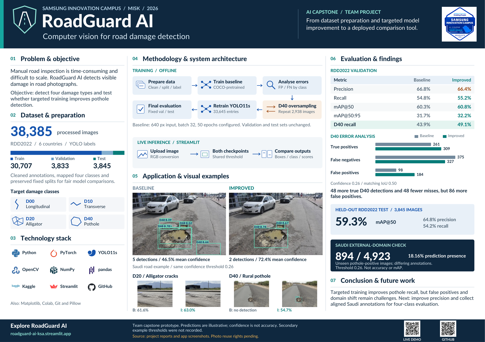

## Project Overview



# RoadGuard AI – Road Damage Detection

AI-powered road damage detection using YOLO11s and the RDD2022 dataset.

Developed as a team capstone project during Samsung Innovation Campus 2026, in partnership with Misk.

## Live Demo

[Try RoadGuard AI](https://roadguard-ai-ksa.streamlit.app/)

The application compares the baseline and improved models side by side using the same uploaded image and confidence threshold.

## What This Project Does

The project detects four types of road damage:

| Class | Meaning |
| --- | --- |
| D00 | Longitudinal crack |
| D10 | Transverse crack |
| D20 | Alligator crack |
| D40 | Pothole |

The application provides:

- Side-by-side model comparison.
- Adjustable confidence threshold.
- Bounding boxes and damage classifications.
- Detection counts and class summaries.
- Individual and mean confidence scores.

## Dataset

The project uses the RDD2022 dataset, which contains road images collected from six countries.

After data preparation, 38,385 images were used:

| Split | Images |
| --- | ---: |
| Training | 30,707 |
| Validation | 3,833 |
| Testing | 3,845 |

The improved model uses D40-focused oversampling to improve pothole detection while keeping the validation and test sets unchanged.

## Technology Stack

- Python
- PyTorch
- Ultralytics YOLO11s
- OpenCV
- NumPy
- Pandas
- Matplotlib
- Pillow
- Streamlit
- Google Colab
- Kaggle
- Git and GitHub

## Main Folders

- `app/` - Streamlit application.
- `data/` - Dataset documentation and exploratory data analysis.
- `notebooks/` - Data preparation, training and evaluation notebooks.
- `reports/baseline/` - Baseline model and training results.
- `reports/improved/` - Improved model and training results.
- `reports/final_evaluation/` - Final model evaluation and comparison.
- `reports/saudi_evaluation/` - Saudi external-domain evaluation.
- `research-and-development/` - Research and development experiments.

The full dataset is not included in the repository due to its size.

## Setup

Create a virtual environment and install the required dependencies:

```powershell
python -m venv .venv
.\.venv\Scripts\Activate.ps1
pip install -r requirements.txt
```

Python 3.12 is recommended.

## Run the Application

From the repository root, run:

```powershell
streamlit run app/app.py
```

Open the local URL displayed in the terminal, upload a road image, and compare the predictions from both models.

Alternatively, use the hosted application:

https://roadguard-ai-ksa.streamlit.app/

## Model Results

### Validation Results

| Metric | Baseline | Improved |
| --- | ---: | ---: |
| Precision | 66.8% | 66.4% |
| Recall | 54.8% | 55.2% |
| mAP@50 | 60.3% | 60.8% |
| mAP@50:95 | 31.7% | 32.2% |
| D40 Recall | 43.9% | 49.1% |

### Pothole Error Analysis

| Metric | Baseline | Improved |
| --- | ---: | ---: |
| True Positives | 261 | 309 |
| False Positives | 98 | 184 |
| False Negatives | 375 | 327 |

Evaluation settings:

- Confidence threshold: 0.26
- Matching IoU threshold: 0.50

The improved model detected 48 additional true pothole instances and reduced missed detections by 48, with an increase in false positives.

### Held-Out Test Results

The improved model was evaluated on 3,845 held-out RDD2022 images.

| Metric | Result |
| --- | ---: |
| Precision | 64.8% |
| Recall | 54.2% |
| mAP@50 | 59.3% |
| mAP@50:95 | 30.5% |

[Full Evaluation Report](reports/final_evaluation/README.md)

## Saudi External-Domain Evaluation

The improved model was also evaluated on Saudi road images that were not used during training.

- Saudi pothole-positive images evaluated: 4,923
- Images with at least one prediction: 894
- Images without predictions: 4,029
- Prediction presence rate: 18.16%
- Confidence threshold: 0.26

Due to differences in annotation schemes and class definitions, these results represent prediction presence rather than directly comparable accuracy or mAP.

[Saudi Evaluation Files](reports/saudi_evaluation/)

## Limitations and Future Work

- Improve generalization to Saudi road conditions.
- Reduce false positives and missed detections.
- Collect locally annotated road images.
- Explore further improvements in class balance and model performance.

RoadGuard AI is a computer vision prototype developed for learning, experimentation and demonstration.
